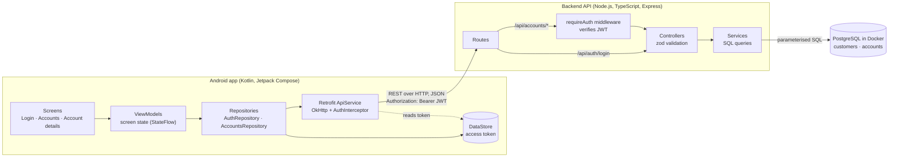
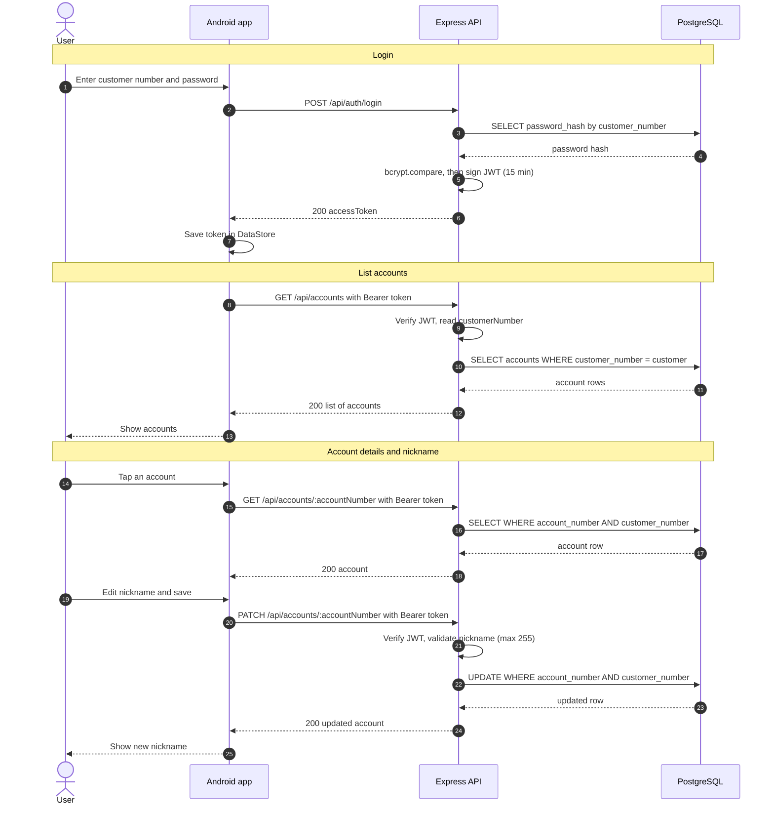
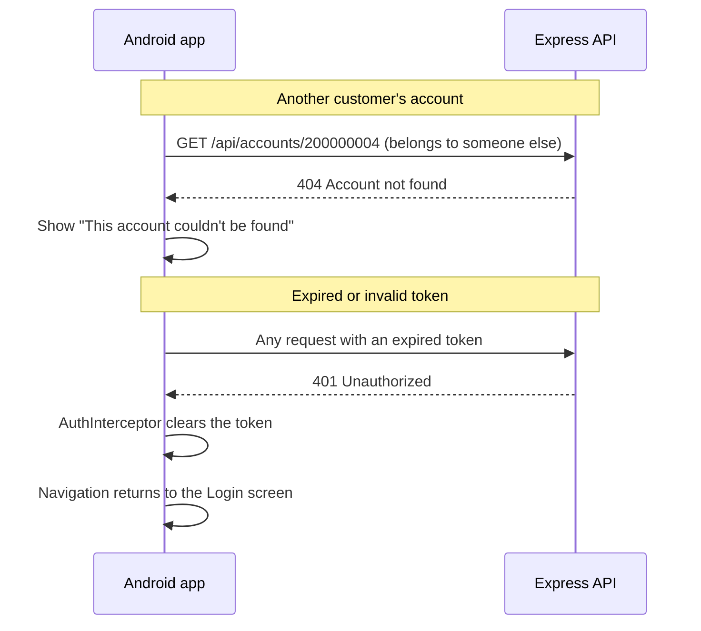
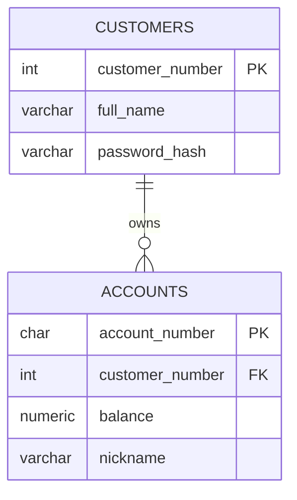

# Architecture

How the Android app, the backend API and the database communicate.

## Components

- **Android** follows MVVM: screens only draw state, ViewModels hold screen state,
  repositories are the single source of data, and Retrofit handles HTTP.
- **AuthInterceptor** adds the token to every request, and clears it on a 401.
- **Backend** is layered: routes → (auth middleware) → controllers (validation)
  → services (database).

## Main flow: login, list accounts, update nickname

## Error handling

## Data model

## Security decisions

| Concern | How it's handled |
|---|---|
| Passwords | Stored as bcrypt hashes, never in plain text |
| Authentication | JWT signed with a server secret, expires after 15 minutes |
| Access to other customers' accounts | Every query filters by the customer in the token; foreign accounts return 404, so their existence isn't revealed |
| SQL injection | Parameterised queries only |
| Input validation | zod on the API, plus database constraints (9 digits, max 255 characters) |
| Token on the device | Stored in the app's private DataStore; app backup disabled |
| Network | Cleartext HTTP allowed only for the emulator's `10.0.2.2`; production would use HTTPS |
| Logs | Request logging only in debug builds, with the Authorization header redacted |